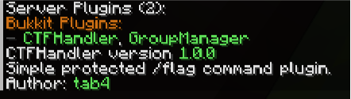
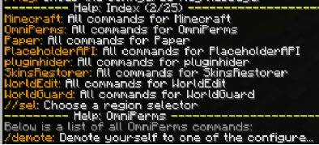
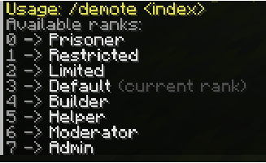
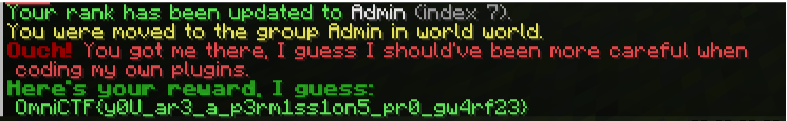

# Permissiondenied
## Game (game)

Typing 
```sh
/plugins
``` 
in chat and clicking on CTFHandler gets you this output:


Which defined the objective: get permission to the 
```sh
/flag
``` 
command and get to the flag (trying this with your current permissions fails). 
On the second page on the output of the command 
```sh
/bukkit:?
```
, you find an odd family of commands named “OmniPerms”, consisting of 1 member: 
```sh
/demote
```




By default, you start with rank 3 and can only demote yourself to a lower rank… Or at least that’s what they want you to think!
Typing the command 
```sh
/demote -1
```
promotes you to the upper rank next to your current rank. Being rank Default, typing 
```sh 
/demote -4
``` 
makes you admin, which grants you permission to use the `/flag` command.
